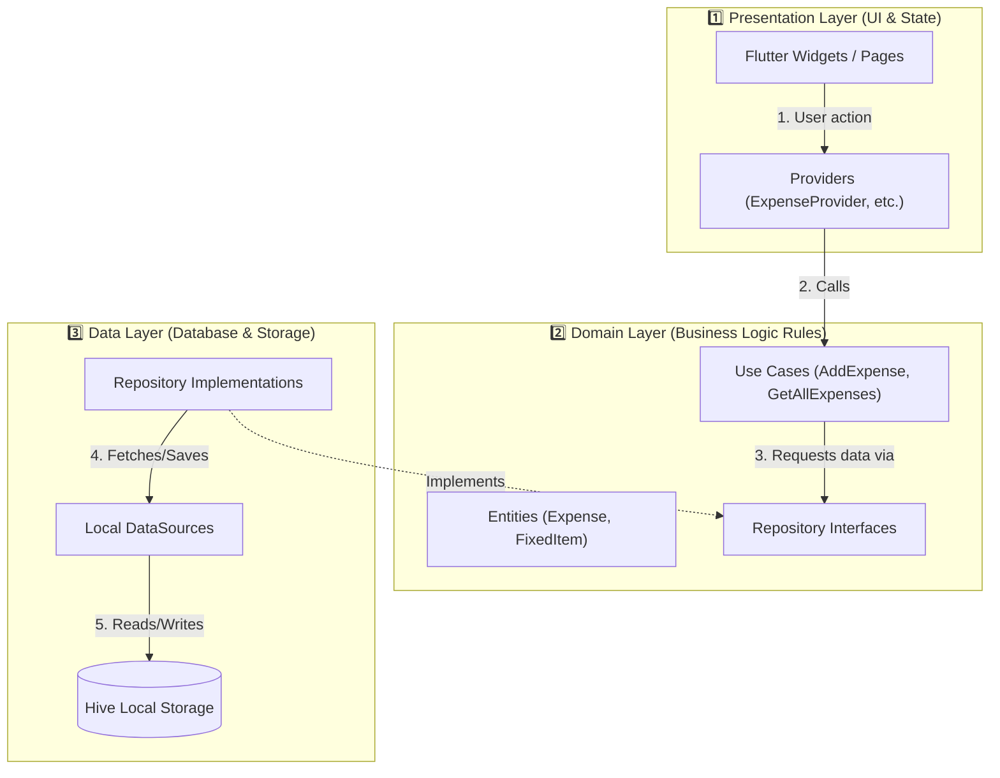

# 🏗️ Architecture & Data Flow Guide

Welcome to the **MyExpenses** codebase guide! This document breaks down the app's architecture into simple, easy-to-understand concepts.

---

## 💡 How the App is Structured (Clean Architecture)

The app is separated into **3 main layers** so that UI, logic, and data storage don't get tangled together:

---

## 📂 Directory Map at a Glance

| Directory | What it contains | Plain English Analogy |
|---|---|---|
| `lib/presentation/` | Pages, Widgets, & Providers | **The Shop Window & Counter** (What the user sees and interacts with) |
| `lib/domain/` | Entities, Use Cases, Repositories (interfaces) | **The Business Rules** (The core rules of how expenses work, independent of UI or database) |
| `lib/data/` | Models, Data Sources, Repositories (implementations) | **The Storage & Filing Cabinet** (How data is saved to Hive local database) |
| `lib/core/` | Themes, Formatters, Constants, Errors | **The Toolbox** (Shared styling, helper functions, and settings) |
| `lib/injection_container.dart` | Service Locator (GetIt) | **The Wiring Center** (Connects all layers together at app startup) |

---

## 🔄 Simple Step-by-Step Data Flow Example

Here is what happens when you **add a new expense**:

1. **User interaction** (`lib/presentation/pages/add_expense/`): User inputs amount and clicks "Save".
2. **State update** (`lib/presentation/providers/expense_provider.dart`): Provider catches the request and notifies the UI.
3. **Business rule** (`lib/domain/usecases/add_expense.dart`): Executes the `AddExpense` use case.
4. **Data saving** (`lib/data/repositories/expense_repository_impl.dart`): Converts the entry into a model and saves it using `ExpenseLocalDataSource`.
5. **Database write** (`lib/data/datasources/expense_data_source.dart`): Stores the record inside **Hive** box on the device.

---

## 🛠️ Quick Tips for Developers

- **Want to change UI styling or layout?** Look in `lib/presentation/pages/` or `lib/presentation/widgets/`.
- **Want to add a new screen/state variable?** Add/modify a Provider in `lib/presentation/providers/`.
- **Want to change how data is saved?** Update `lib/data/datasources/` or `lib/data/models/`.
